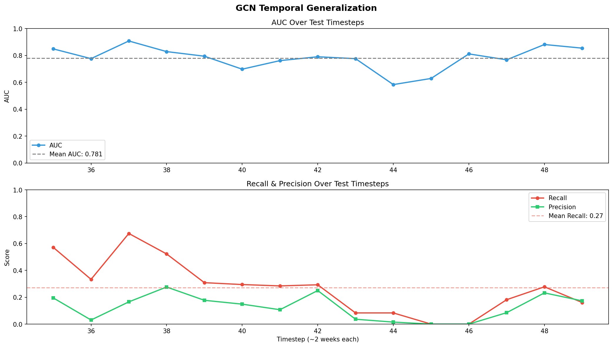
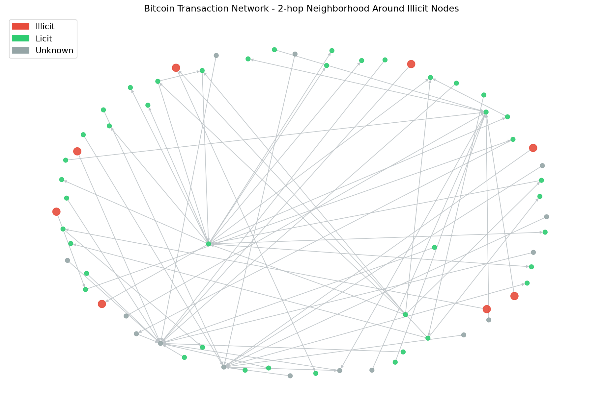

# Bitcoin Fraud Detection with Graph Neural Networks

Detecting illicit transactions in the Bitcoin network using GNNs on the Elliptic dataset.


## The Problem

Financial fraud costs billions annually. Rule-based systems generate 95%+ false positives,
wasting investigator time. Graph Neural Networks detect fraud patterns invisible to 
per-transaction models - illicit transactions cluster in the payment network in ways 
that only emerge when you look at the graph structure.

## Dataset

The [Elliptic Bitcoin Dataset](https://www.kaggle.com/datasets/ellipticco/elliptic-data-set) 
contains 203,769 Bitcoin transactions and 234,355 payment flows, with 2% labeled as illicit.


## Approach

Three models trained on timesteps 1-34 and evaluated on 35-49 (temporal split):

| Model | AUC | Illicit Recall | Illicit Precision |
|-------|-----|---------------|-------------------|
| Random Forest (baseline) | 0.95 | 11% | 74% |
| GCN | 0.80 | 41% | 13% |
| GAT | 0.82 | 43% | 12% |

**Key result:** GNNs detect 4x more fraud than the tabular baseline, 
at the cost of more false positives - the right trade-off when missing 
fraud is more costly than investigating alerts.

## Temporal Analysis

Fraud is not static. The dataset spans 49 timesteps (~2 weeks each), 
and fraud rate oscillates between 0% and 35% depending on the period.
Model performance degrades on later timesteps, confirming that fraud 
patterns evolve over time and static models have fundamental limitations.




## Graph Structure

The network follows a power-law degree distribution typical of real-world graphs.
Illicit nodes have slightly lower average degree (0.74) than licit ones (1.15),
suggesting fraudulent transactions avoid highly connected nodes.


## Graph Visualization

1-hop neighborhood around illicit nodes (timestep 5). Red = illicit, green = licit, gray = unknown.
Illicit nodes tend to cluster together, forming detectable patterns in the transaction network.



## Research extension

The original notebooks and baseline classes are preserved. The research
extension adds `src/data_utils.py`, `src/taf_gnn.py`, `src/temporal_model.py`,
`src/fusion.py`, `src/losses.py`, `src/evaluation.py`, and the experiment
runners. It uses train timesteps 1-28, validation 29-34, and untouched test
timesteps 35-49. `--protocol inductive` filters future graph connections,
whereas the default protocol intentionally reproduces transductive full-graph
message passing.

Install dependencies and run:

```bash
python -m src.baseline_experiments --data-root data/elliptic
python -m src.run_experiments --data-root data/elliptic --output-root results
python -m src.run_experiments --data-root data/elliptic --output-root results --seeds 42,123,2024
python -m src.run_experiments --data-root data/elliptic --output-root results/inductive --protocol inductive
```

Metrics are computed from actual predictions and include ROC-AUC, PR-AUC,
precision, recall, F1, MCC, balanced accuracy, false-positive rate, and the
validation-selected threshold. See [REPORT.md](REPORT.md) for the audit,
mathematical description, research positioning, and limitations.
Repeated-seed runs write per-seed artifacts under `results/seeds/seed_<seed>/`
and aggregate model metrics (mean, standard deviation, and 95% confidence
interval) into the top-level comparison and ablation CSV files. The first
seed also retains the traditional single-seed artifact names.

## Project Structure

```
bitcoin-fraud-gnn/
├── notebooks/
│   ├── 01_eda.ipynb                # Exploratory data analysis
│   ├── 02_baseline.ipynb           # Random Forest baseline
│   ├── 03_gcn.ipynb                # Graph Convolutional Network
│   ├── 04_gat.ipynb                # Graph Attention Network
│   └── 05_temporal_analysis.ipynb  # Temporal generalization analysis
├── src/
│   ├── models.py                   # Original reusable GCN and GAT definitions
│   ├── taf_gnn.py                  # Feature, graph, temporal, and fusion model
│   ├── temporal_model.py           # GRU/LSTM encoder
│   ├── fusion.py                   # Adaptive softmax fusion gate
│   ├── losses.py                   # CE, weighted CE, and focal loss
│   ├── evaluation.py               # Metrics and threshold selection
│   ├── data_utils.py               # Metadata alignment and inductive edge filter
│   ├── baseline_experiments.py     # RF/GCN/GAT common-protocol runner
│   └── run_experiments.py          # TAF-GNN, ablations, and result artifacts
├── app.py                          # Streamlit research interface
├── assets/                         # Plots and visualizations
└── requirements.txt
```

## Key Findings

- Graph structure carries signal invisible to tabular models (+30% recall)
- Illicit nodes have lower average degree (0.74 vs 1.15 for licit nodes),
  suggesting fraudulent transactions avoid highly connected hubs
- Temporal split is critical: random split leaks future fraud patterns into training,
  giving artificially inflated results
- Model performance degrades on later test timesteps, pointing to continual
  learning as a necessary next step for production fraud detection
- The reproducible experiment runner uses train timesteps 1-28, validation
  timesteps 29-34, and test timesteps 35-49; thresholds are selected on
  validation data only

## How to Run

```bash
git clone https://github.com/linovives/bitcoin-fraud-gnn.git
cd bitcoin-fraud-gnn
python -m venv venv
source venv/bin/activate
pip install -r requirements.txt
jupyter lab
```

### Streamlit research interface

From the project root on Windows:

```powershell
streamlit run app.py
```

The interface uses cached local graph data and displays only genuine generated
artifacts when they exist. TAF-GNN predictions, ablation results, fusion
weights, and explainability outputs remain explicit unavailable states until
the corresponding research experiments have produced them.

### Reproducible baseline experiments

The common evaluation runner uses the chronological protocol shown in the UI:

```powershell
python -m src.baseline_experiments --data-root data/elliptic --output results/model_comparison.csv
```

It trains on timesteps 1-28, selects the threshold on 29-34, and reports the
final metrics on 35-49. On Windows, keep the MKL/OpenMP settings used by
`app.py` if PyTorch reports a `c10.dll` initialization error.

## Author

**Lino Vives** - Mathematics & Software Engineering student  
[LinkedIn](https://linkedin.com/in/lino-vives)
